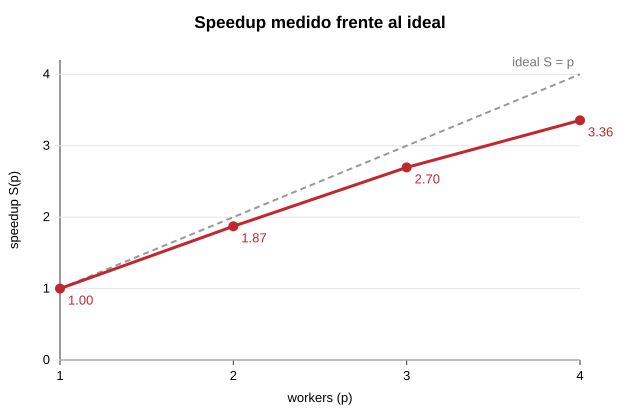

# Análisis de speedup

**Equipo:** andler-soto  
**Integrantes:** Álvaro Andler y Elías Soto  
**Fecha:** 26-11-2026

Trabajo autónomo de la Semana 13. Plazo jueves 26-11-2026 a las 18.00. Máximo una plana.

## 1. Resultados

Tabla de `graficar.py` y el gráfico `mediciones/speedup.svg` enlazado.

```text
  p  corridas    T(p) s    S(p)    E(p)  Karp-Flatt
  1         2     18.94    1.00    1.00           -
  2         2     10.12    1.87    0.94       0.069
  3         2      7.02    2.70    0.90       0.056
  4         2      5.64    3.36    0.84       0.064
```



## 2. ¿Por qué el speedup no es lineal?

Expliquen con sus datos al menos tres causas. Para cada una digan qué evidencia la respalda.

- **Parte serial del master (publicar tareas, juntar resultados). Usen la columna Karp-Flatt.**  
Los valores de Karp-Flatt se encuentran entre 0.056 y 0.069, lo que indica una fracción serial efectiva aproximada del 6 %

- **Recursos físicos (CPU asignadas a Docker, otros programas abiertos).**  
Cada uno de los 40 trozos requiere el intercambio de mensajes con RabbitMQ. La eficiencia disminuyó de 0.94 con 2 workers a 0.84 con 4 workers, lo que es compatible con este costo, aunque no se midió de forma aislada

- **Costo de comunicación (ida y vuelta al broker por cada trozo, serialización JSON).**  
En la segunda medición con 4 workers, se repartieron 10, 11, 10 y 9 trozos. El prefetch=1 ayudó a distribuir el trabajo según la disponibilidad de cada worker

- **Desbalance de carga (los trozos altos cuestan más que los bajos). ¿Ayudó prefetch=1?**  
Docker tiene asignadas 16 CPU. Como utilizamos un máximo de 4 workers, no tenemos evidencia de haber alcanzado el límite de CPU

## 3. Experimento propio

**Cambien una variable y midan de nuevo. Por ejemplo `TROZOS=8` frente a `TROZOS=200`, o `N` más grande. Expliquen qué esperaban, qué obtuvieron y por qué.**

Se modificó la cantidad de trozos, manteniendo 4 workers y N=5000000

| Trozos | Tiempo (s) |
|---:|---:|
| 8 | 6.073 |
| 40 | 5.645 |
| 200 | 5.449 |

Esperábamos que con una mayor cantidad de trozos se distribuyera mejor el trabajo, aunque aumentara la comunicación con RabbitMQ  
Con 8 trozos, los workers tuvieron tiempos de trabajo entre 3.89 y 6.07 segundos, mientras que con 200 trozos estuvieron entre 5.28 y 5.41 segundos  
En esta prueba, el mejor reparto de carga compensó el costo adicional de comunicación y permitió obtener un menor tiempo de ejecución

## 4. Conclusión para el proyecto integrador

**¿Cuántos workers usarían en su proyecto y por qué?**  
Utilizaríamos inicialmente 2 workers para procesar los pedidos pendientes y asignarlos al vehículo más cercano, como se establece en el alcance del proyecto  
Con 2 workers obtuvimos un speedup de 1.87 y una eficiencia del 94 %. Además, permitiría continuar procesando pedidos si uno de los workers falla, utilizando ACK manual para permitir la reentrega  
La cantidad de workers podría aumentar dependiendo de la carga de pedidos
